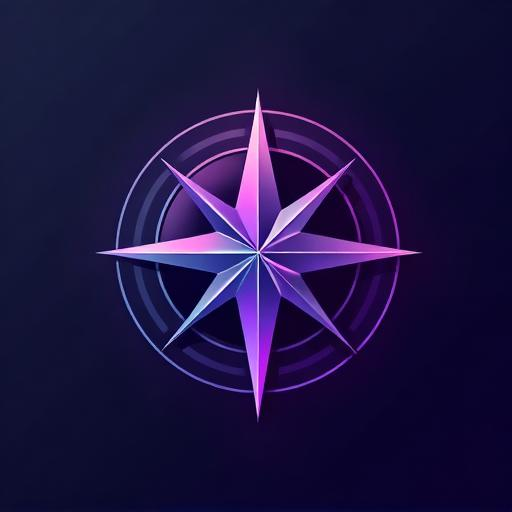
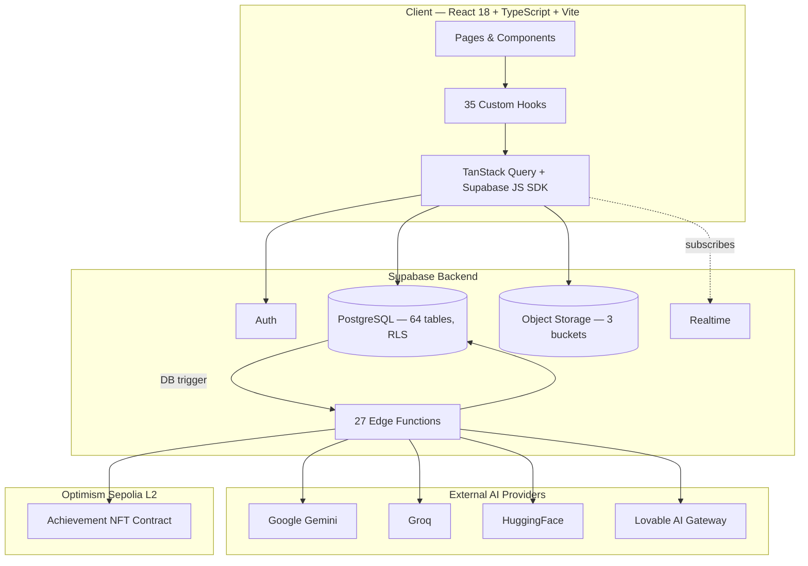

<div align="center">
  

  # VeriScape

  ### Turn real-world exploration into a trusted, AI-verified knowledge atlas

  *Embark on AI-powered quests that transform the world into your personal adventure playground.*

  
  
  
  
  
  
  

</div>

---

> **A note on naming:** the product is branded **VeriScape** in the UI, but you'll see its working codename **Discovery Atlas** throughout the codebase, database, and internal docs — the project was renamed partway through development and the two names are used interchangeably below.

## Table of Contents

- [Overview](#overview)
- [Why VeriScape](#why-veriscape)
- [Feature Highlights](#feature-highlights)
- [The AI Layer](#the-ai-layer)
- [Research: Beyond the Production Pipeline](#research-beyond-the-production-pipeline)
- [Architecture](#architecture)
- [Tech Stack](#tech-stack)
- [Database Schema](#database-schema)
- [Project Structure](#project-structure)
- [Getting Started](#getting-started)
- [Roadmap](#roadmap)
- [Author](#author)
- [License](#license)

---

## Overview

VeriScape is a cloud-native platform that turns real-world exploration into a structured, evidence-based, and gamified experience. Rather than letting users simply post photos of places they've been, VeriScape assigns **AI-generated discovery quests**, requires **photographic proof** of completion, runs that proof through a **multi-agent AI verification pipeline**, and only then admits the discovery into a permanent, shared **community knowledge atlas**.

It sits at the intersection of a social exploration app, a citizen-science tool, and a trust layer for user-generated location data — built end-to-end on React, Supabase, and a small constellation of purpose-built AI agents, with achievement NFTs, a native mobile shell, and its own in-house computer vision research on the side.

At a glance, the codebase spans:

| | |
|---|---|
| **117** commits over 8+ months (Aug 2025 – Apr 2026) | **21** route-level pages |
| **~90** React components across **27** feature folders | **35** custom hooks |
| **64** database tables · **190** RLS policies · **24** DB functions | **27** serverless Edge Functions |
| **42** SQL migrations | **3** AI agents + 8 supporting AI functions |

## Why VeriScape

Most location-based and social apps take submitted content at face value — a check-in, a photo, a review — with no structural way to verify it actually happened where it claims to have happened. VeriScape's core bet is that **verification + gamification**, done properly, produces something more valuable than either alone: a growing, trustworthy record of real-world discoveries, built by people who are having fun doing it.

Every submission is expected to clear:

- **Provenance checks** — EXIF metadata inspection, GPS geofencing against the quest location, timestamp/camera consistency
- **Content checks** — AI scene analysis comparing the photo against the quest's expected subject matter
- **Authenticity checks** — deepfake and AI-generated-image screening
- **Fraud checks** — cross-referencing against prior submissions for suspicious similarity

Only submissions that clear a confidence threshold become part of the permanent record. Everything else is rejected, queued for manual review, or routed into an AI-assisted appeals flow — see [The AI Layer](#the-ai-layer) for how that scoring actually works.

## Feature Highlights

### 🗺️ Quest System
- AI-generated, personalized quests based on location, interests, history, and difficulty preference
- Photo-proof submission with multi-image upload and geolocation capture
- Searchable, filterable quest browser with categories and difficulty ratings
- Interactive quest map (Leaflet) with marker clustering and discovery heatmaps
- **Quest Chains** — multi-step storyline quests with sequential unlock conditions
- **Seasonal Events** — limited-time holiday quests with bonus XP and exclusive rewards
- **AR Explorer** — location-based augmented-reality collectible markers
- **Adaptive difficulty** — recommended difficulty derived from user level and success rate

### 🤖 AI Verification & Agents
Full breakdown in [The AI Layer](#the-ai-layer) — multi-factor photo verification, an AI quest-generation agent, an AI knowledge/hints companion, natural-language quest search, and automated content moderation.

### 🏆 Gamification
- XP and leveling, with animated level-up moments
- Badges and achievements with custom unlock logic
- Daily and weekly challenges with automatic progress tracking
- Power-up shop, inventory, activation, and expiry system
- Streak tracking and a global leaderboard

### 👥 Social & Community
- Unified community feed combining posts and quest submissions, with likes, comments, and shares
- Follow / unfollow system with private accounts and follow requests
- Direct messaging with replies
- **Social Clubs** — interest-based groups with their own feeds and membership
- Live, realtime activity feed

### 🤝 Teams & Crews
- Team creation and membership, team chat, and team challenges with reward distribution
- Crews — larger community groupings with a dedicated navigation surface

### ⛓️ Blockchain / NFTs
- Achievement badges are minted as NFTs on **Optimism Sepolia** (L2 testnet) the moment they're unlocked
- Automatic wallet provisioning per user (individually or in batch, from the admin panel)
- A verification ledger guards against duplicate minting

### 📱 Mobile & PWA
- Capacitor-wrapped native shell with camera, geolocation, and push-notification plugins configured
- Installable Progressive Web App with an offline indicator and update prompts
- Native-feeling camera/geolocation capture flows on device

### 🔔 Notifications
- In-app notification center plus Web Push for the PWA
- Preferences per notification type (quest verdicts, badges, social activity, team invites, and more)

### 🛠️ Admin Console
- Verification log viewer and manual review queue
- Points and team-challenge management
- Batch wallet creation and full database JSON export
- Role-based access across admin / moderator / user

## The AI Layer

VeriScape doesn't rely on one general-purpose "AI verification" call — it's built around several purpose-specific agents, each its own Supabase Edge Function, calling out to Gemini, Groq, HuggingFace, or the Lovable AI Gateway depending on the job.

#### 🕵️ Verification Agent — `ai-verification-agent`
The core trust engine. For every quest submission it runs a weighted, multi-factor scoring pass:

| Signal | What it checks |
|---|---|
| Geolocation match | Distance between the submission's GPS coordinates and the quest's target location |
| Authenticity | EXIF presence/consistency and deepfake / AI-generation screening |
| Scene relevance | Vision-model comparison between the photo and the quest's expected subject matter |
| Quest/text match | Whether the submitted description actually matches the quest |

Each run resolves to **verified**, **uncertain** (routed to manual review), or **rejected**, with every per-factor score logged for auditability. Rejected users can open an **AI-reviewed appeal**, and the agent separately runs **cross-reference fraud detection** to flag submissions that look suspiciously similar to earlier ones. Verification confidence thresholds are stored as data and tunable by admins at runtime — recalibrating the system doesn't require a redeploy.

#### 🧭 Quest Master Agent — `quest-master-agent`
Owns the quest lifecycle end-to-end: generating new personalized quests, assembling multi-step Quest Chains, retiring stale quests, and orchestrating collaborative/team quests — driven by each user's history, location, level, and success rate via the Lovable AI Gateway.

#### 📚 Knowledge Agent — `quest-knowledge-agent`
A conversational companion for the "knowledge atlas" side of the platform: chats with users about a quest's subject matter, offers contextual hints, surfaces facts, and runs quizzes — adapting depth to each user's tracked engagement with that topic.

Rounding out the pipeline, single-purpose functions handle the rest of the AI surface area: `ai-content-moderation`, `ai-quest-search` (natural-language search over quests), `ai-generate-quest-image`, `deepfake-detection` / `deepfake-analysis` (HuggingFace), and `groq-analysis` for low-latency inference where Gemini's latency isn't needed.

## Research: Beyond the Production Pipeline

Two Jupyter notebooks in the repo point toward where verification is headed next. Both are training/R&D notebooks — not yet wired into the live Edge Functions — but they represent real, from-scratch model work rather than an off-the-shelf API call:

- **GeoFuse** (`AI Verification.ipynb`) — a visual geolocation model: an EfficientNet-B3 backbone fine-tuned on the OpenStreetView-5M dataset with S2-geocell classification labels, hard-negative mining via FAISS descriptor search, and weighted sampling to handle class imbalance. The goal is to verify a photo's *location* from its visual content alone, rather than trusting EXIF GPS data, which can be stripped or spoofed.
- **AI-generated image detector** (`ai-generated-image-detection-vit.ipynb`) — a real-vs-AI-generated binary image classifier, built on an EfficientNet backbone with an Albumentations-based augmentation pipeline and a full evaluation/visualization loop, aimed at catching AI-generated "discoveries" that the production deepfake check might miss.

Together they sketch the next iteration of the authenticity pipeline: visual geo-verification and generative-image detection trained in-house rather than bought off the shelf.

## Architecture



The system leans on Supabase's **event-driven, serverless model** rather than a traditional always-on application server. A representative flow, from submission to reward:

1. A user submits photo evidence for a quest → the row lands in `Submissions`.
2. A database trigger fires automatically, invoking the `ai-verification-agent` Edge Function.
3. The agent scores the submission across its verification signals and writes a verdict back to `ai_verifications`.
4. On approval, downstream triggers award XP, check for newly-unlocked badges/achievements, and update challenge and streak progress.
5. If a badge was earned, `mint-achievement-nft` mints it on Optimism Sepolia and links the on-chain record back to the user's profile.
6. A notification is generated and pushed to the client in realtime.

No polling, no manual moderation queue for the happy path — the database's own trigger graph drives the workflow.

## Tech Stack

**Frontend**

| Category | Technology |
|---|---|
| Framework | React 18.3, TypeScript, Vite 5 (SWC) |
| Styling | Tailwind CSS, shadcn/ui (Radix primitives) |
| Data & forms | TanStack Query, React Hook Form + Zod |
| Routing | React Router v6 |
| Animation | Framer Motion, GSAP |
| Maps | Leaflet / React Leaflet with clustering + heatmap plugins |
| 3D | Three.js |
| Charts | Recharts |

**Backend**

| Category | Technology |
|---|---|
| Database | Supabase Postgres — 64 tables, 190 RLS policies, 24 DB functions |
| Auth | Supabase Auth |
| Storage | Supabase Storage — 3 buckets (`quest-submissions`, `community-images`, `avatars`) |
| Realtime | Supabase Realtime (notifications, team chat, live activity) |
| Serverless | 27 Supabase Edge Functions (Deno) |

**AI**

| Category | Technology |
|---|---|
| Vision & language | Google Gemini, Lovable AI Gateway |
| Fast inference | Groq |
| Deepfake detection | HuggingFace Inference API |
| Research | Custom EfficientNet models (PyTorch/timm) for geolocation and AI-image detection |

**Blockchain & Mobile**

| Category | Technology |
|---|---|
| Blockchain | Optimism Sepolia (L2 testnet), custom achievement NFT contract |
| Native shell | Capacitor (Camera, Geolocation, Push Notification plugins) |
| PWA | Installable, offline indicator, Web Push |

**Tooling**

| Category | Technology |
|---|---|
| Build & lint | Vite, ESLint, TypeScript |
| Testing | Vitest, Testing Library |
| Deployment | Vercel-ready (`vercel.json`); prototyped and iterated on via Lovable |

## Database Schema

64 tables organized into nine functional domains:

| Domain | Tables | Examples |
|---|---|---|
| Identity & Access | 6 | `profiles`, `Users`, `user_roles`, `follows`, `follow_requests`, `blocked_users` |
| Quests & Progression | 10 | `Quests`, `Submissions`, `quest_chains`, `quest_routes`, `user_quest_stats` |
| Gamification | 10 | `Badges`, `achievements`, `challenges`, `powerups`, `xp_logs`, `daily_exercises` |
| AI Verification | 8 | `ai_verifications`, `ai_agent_config`, `verification_appeals`, `verification_thresholds` |
| Social | 10 | `community_posts`, `direct_messages`, `social_groups`, `post_shares` |
| Teams & Crews | 8 | `teams`, `team_challenges`, `team_messages`, `crews`, `crew_members` |
| Events & AR | 7 | `seasonal_events`, `ar_quest_markers`, `user_ar_collections`, `events` |
| Notifications & Ops | 4 | `notifications`, `notification_preferences`, `push_subscriptions`, `content_reports` |
| Blockchain | 1 | `verification_ledger` |

<details>
<summary>Full table list (click to expand)</summary>

`Badges` · `Quests` · `Submissions` · `Users` · `achievements` · `ai_agent_config` · `ai_generated_quests` · `ai_logs` · `ai_verifications` · `ar_quest_markers` · `blocked_users` · `challenges` · `community_post_comments` · `community_post_likes` · `community_posts` · `content_reports` · `crew_members` · `crews` · `daily_exercises` · `direct_messages` · `event_quests` · `events` · `follow_requests` · `follows` · `moderation_logs` · `notification_preferences` · `notifications` · `post_comments` · `post_likes` · `post_shares` · `powerups` · `profiles` · `push_subscriptions` · `quest_chain_steps` · `quest_chains` · `quest_conversations` · `quest_learning_engagement` · `quest_routes` · `seasonal_event_participation` · `seasonal_event_quests` · `seasonal_events` · `social_group_members` · `social_group_posts` · `social_groups` · `suggested_quests` · `team_challenge_progress` · `team_challenges` · `team_members` · `team_messages` · `team_quest_completions` · `teams` · `user_achievements` · `user_ar_collections` · `user_challenges` · `user_powerups` · `user_quest_chain_progress` · `user_quest_stats` · `user_roles` · `verification_appeals` · `verification_cross_references` · `verification_feedback` · `verification_ledger` · `verification_thresholds` · `xp_logs`

</details>

Relational integrity is enforced with foreign-key constraints; access control is enforced with **Row-Level Security** on every table, so authorization lives in the database itself rather than solely in application code.

## Project Structure

```text
VeriScape/
├── src/
│   ├── assets/                # Logo and static image assets
│   ├── components/
│   │   ├── admin/             # Verification logs, wallets, DB export, points management
│   │   ├── gamification/      # XP, achievements, challenges, power-ups
│   │   ├── quest/             # Quest map, sidebar, walkthrough, AI generator
│   │   ├── social/             # Follow system, community feed
│   │   ├── teams/               # Team dialogs, chat, challenges
│   │   ├── verification/         # Verification progress & result UI
│   │   ├── native/                # Capacitor camera/geolocation capture
│   │   ├── pwa/                     # Install prompt, offline indicator
│   │   ├── notifications/            # Notification center
│   │   ├── landing/                   # Marketing landing page sections
│   │   ├── ui/                         # 64 shadcn/ui primitives
│   │   └── ...                          # difficulty, streak, search, settings, games, chat, etc.
│   ├── hooks/                  # 35 custom hooks (auth, quests, AR, adaptive difficulty, agents...)
│   ├── integrations/supabase/  # Auto-generated Supabase client & types
│   ├── pages/                  # 21 route-level pages
│   ├── services/                # AI verification & enhancement service wrappers
│   └── utils/
├── supabase/
│   ├── config.toml             # Per-function JWT verification config
│   ├── functions/               # 27 Edge Functions (Deno)
│   └── migrations/                # 42 SQL migrations (Aug 2025 – Mar 2026)
├── sql config files/            # Standalone setup/fix SQL scripts
├── project details files/       # Feature-specific setup docs
├── report/                       # Internal architecture report & changelog
├── AI Verification.ipynb          # GeoFuse visual-geolocation research notebook
├── ai-generated-image-detection-vit.ipynb  # Real-vs-AI image classifier notebook
└── capacitor.config.ts             # Native mobile shell configuration
```

## Getting Started

### Prerequisites
- Node.js 18+ and npm
- A Supabase project (the free tier is enough to start)
- API keys for whichever AI providers you want to enable — the app runs without them, but AI-dependent features stay inactive

### 1. Clone & install
```bash
git clone https://github.com/SBLab25/VeriScape.git
cd VeriScape
npm install
```

### 2. Configure environment
```bash
cp .env.example .env
```
Fill in your own Supabase project's values:

| Variable | Description |
|---|---|
| `VITE_SUPABASE_URL` | Your Supabase project URL |
| `VITE_SUPABASE_PUBLISHABLE_KEY` | Supabase anon/publishable key |
| `VITE_SUPABASE_PROJECT_ID` | Supabase project reference |

### 3. Set up the database
Run the migrations in `supabase/migrations/` against your Supabase project, in order, via the Supabase CLI or SQL editor. A few features documented under `project details files/` (gamification, the follow system, notifications, NFT webhooks) call for one additional setup script or manual secret — see the corresponding `*_SETUP.md` file for each.

### 4. Configure Edge Function secrets
In your Supabase project's Edge Function settings, add whichever of these you want active:

| Secret | Powers |
|---|---|
| `GEMINI_API_KEY` | Photo verification, quest generation, content moderation |
| `LOVABLE_API_KEY` | Quest Master & Knowledge agents (Lovable AI Gateway) |
| `GROQ_API_KEY` | Fast LLM analysis |
| `HUGGINGFACE_API_KEY` | Deepfake detection |
| `MINTER_PRIVATE_KEY`, `NFT_CONTRACT_ADDRESS` | Achievement NFT minting |

Then deploy:
```bash
supabase functions deploy
```

### 5. Run it
```bash
npm run dev
```
The app runs at `http://localhost:8080`.

### Building for mobile
```bash
npm run build
npx cap sync
npx cap open ios   # or: npx cap open android
```

## Roadmap

- Native iOS/Android builds from the existing Capacitor scaffold
- CI/CD with expanded automated test coverage (Vitest is already wired in)
- Mainnet migration for NFT minting (currently Optimism Sepolia testnet)
- Graduating the GeoFuse research notebook into a deployed visual geo-verification Edge Function
- Broader multi-provider AI routing through the Lovable AI Gateway
- An analytics dashboard for engagement and quest-performance insights
- Internationalization / multi-language support
- A quest marketplace for user-generated quest packs

## Author

**Sovan Bhakta**
- GitHub: [@SBLab25](https://github.com/SBLab25)
- Portfolio: [portfolio-sovan.netlify.app](https://portfolio-sovan.netlify.app)
- LinkedIn: [linkedin.com/in/sovanbhakta](https://linkedin.com/in/sovanbhakta)

## License

No open-source license has been published for this repository yet — all rights are reserved by the author. If you'd like to use, fork, or build on this project, please reach out first.
